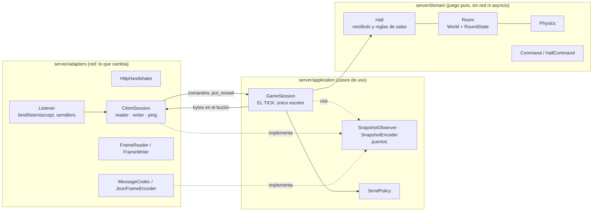
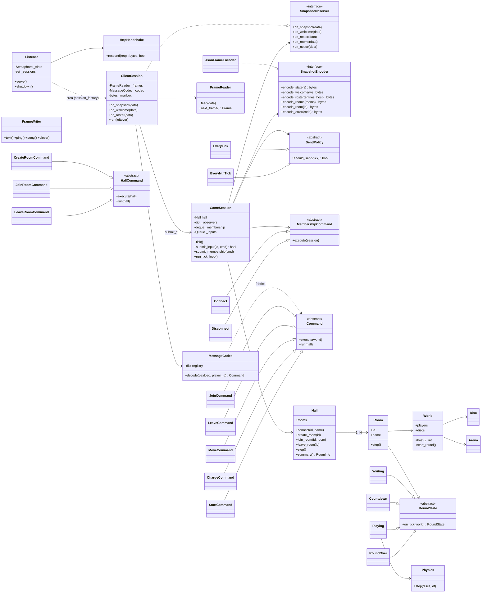

# Arquitectura de StreetPunch (la del código real)

Este documento describe lo que **hay** en `server/`, no lo planeado. Si el código
cambia, esto se actualiza con él.

## 1. Estilo: hexagonal (puertos y adaptadores) con un único escritor



**Regla de dependencias:** las flechas apuntan hacia adentro. `domain` no importa
`asyncio` ni `socket` (se prueba con `pytest` sin abrir un socket).
`application` conoce **interfaces** (`SnapshotObserver`, `SnapshotEncoder`), nunca
un WebSocket. `server/main.py` es el único lugar que construye y conecta los
objetos (`build()`), por inyección de dependencias en los constructores.

**Flujo de datos (un solo sentido de escritura):**

```
navegador ──trama──> reader ──Command──> cola acotada ──> TICK ──> Hall ──> Room (World + fase)
                                                            │
navegador <──trama── writer <── buzón (tamaño 1) <──bytes──┘   (estado de SU sala, 1 vez por tick)
```

El tick es el **único** que modifica el vestíbulo, las salas y la lista de
observadores. Conectarse, salir, crear/unirse/salir de una sala, iniciar,
moverse y cargar son comandos que el tick ejecuta; ninguna otra tarea toca esas
estructuras, así que no hace falta ningún `Lock`. Un solo tick avanza **todas**
las salas, una tras otra.

**Salas.** `Hall` (domain) sabe quién está conectado, qué salas hay y en cuál está
cada jugador, y aplica las reglas (tope de 8, solo se entra en espera, sala vacía
desaparece) sin ninguna red. Cada `Room` es un `World` propio más su fase.

## 2. Diagrama de clases



## 3. Patrones GoF: qué problema de arquitectura resuelve cada uno

| Patrón | Dónde | Problema concreto que resuelve | Qué pasaría sin él |
| --- | --- | --- | --- |
| **State** | `RoundState` y `Waiting`/`Countdown`/`Playing`/`RoundOver` (`server/domain/round_states.py`) | El tick no pregunta "¿en qué fase estoy?": llama a `state.on_tick(world)` y recibe la siguiente fase. Cada fase conoce solo su regla (la sala espera al anfitrión, la cuenta cancela si alguien se va...). | Un `if phase == ...` largo dentro del tick que crece con cada fase (viola OCP). |
| **Command** | `Command`, `HallCommand` y sus hijas, `MembershipCommand` (`server/domain/commands.py`, `server/application/session_commands.py`) | Separa **cuándo llega** una orden (en la tarea `reader`, en cualquier momento) de **cuándo se ejecuta** (dentro del tick). Es la base del único escritor: el reader crea el comando y lo encola; solo el tick lo ejecuta. Con `run(hall)` (doble despacho) el tick no distingue una orden de partida de una de sala. | Cada reader modificaría el mundo directamente: carreras de datos y la necesidad de cerrojos. |
| **Observer** | `SnapshotObserver` (puerto) y `ClientSession` (observador) | El tick publica estado sin saber quién lo recibe ni cómo se envía; los clientes se suscriben y se dan de baja. | `GameSession` conocería sockets (rompería la arquitectura hexagonal). |
| **Strategy** | `SendPolicy` con `EveryTick` / `EveryNthTick` | Decide a qué frecuencia se envía el estado de una sala según su **fase** (30 Hz jugando, 10 Hz en espera/cuenta/resultados) sin tocar el tick. | `if fase == "playing"` dentro del bucle de difusión. |
| **Factory Method (por registro)** | `MessageCodec` con el registro `{tipo: fábrica}` (`server/adapters/codec.py`) | Convierte un mensaje JSON en un `Command`. Un mensaje nuevo (`start`, `create`, `join`, `leave`) es **una entrada nueva en el registro**, no otro `elif`. | Un `if/elif` por tipo de mensaje en el reader. |

Otras decisiones que no son GoF y se defienden igual: **buzón de tamaño 1** por
cliente (backpressure: pisa el estado viejo), **semáforo** (tope de 100
conexiones), **inyección de dependencias** en `main.build()`.

## 4. SOLID: dónde se ve

- **S**: `FrameReader` solo parte bytes en tramas; `HttpHandshake` solo el saludo; `Physics` solo mueve discos; `Metrics` solo cuenta; `Hall` solo decide quién está en qué sala; `World` solo una partida.
- **O**: agregar un tipo de mensaje, una fase o una política de envío es **agregar una clase o una entrada** de registro; el tick no se toca.
- **L**: toda `RoundState` cumple el contrato "`on_tick` no lanza y devuelve un `RoundState`" (hay una prueba de fuzz con 5000 ticks al azar, `tests/test_round_states.py`); todo `Command` es seguro aunque el jugador ya se haya ido.
- **I**: los puertos son pequeños (`SnapshotObserver` solo recibe bytes ya codificados; `SnapshotEncoder` solo codifica).
- **D**: `GameSession` depende de `SnapshotObserver`/`SnapshotEncoder` (abstracciones); `main.build()` inyecta las concretas.

## 5. Concurrencia: qué tarea toca qué

| Tarea | Lee | Escribe | Nunca |
| --- | --- | --- | --- |
| `tick` (una) | todo | **vestíbulo, salas**, observadores, buzones | `await` sobre un socket |
| `reader` (una por cliente) | su socket | la cola de entradas (`put_nowait`) y las casillas de control | el vestíbulo ni las salas |
| `writer` (una por cliente) | su buzón y casillas (estado, roster, rooms, avisos) | **su** socket (única tarea que lo hace) | el vestíbulo ni las salas |
| `ping` (una por cliente) | — | la casilla de ping | el socket directamente |
| `Listener.serve` | — | semáforo, registros de sesiones | el mundo |

Región crítica del tick: no tiene ningún `await` entre leer y modificar el mundo,
por eso una sola tarea puede modificarlo sin cerrojos (en un solo hilo con
`asyncio`, otra tarea solo se intercala en un `await`).

## 6. Comparación con la versión mala

`git checkout demo/race-bug` (etiqueta `demo-race-bug-v1`) rompe tres de estas
reglas a propósito; ver `docs/demo-race-bug.md` para qué se mide.
