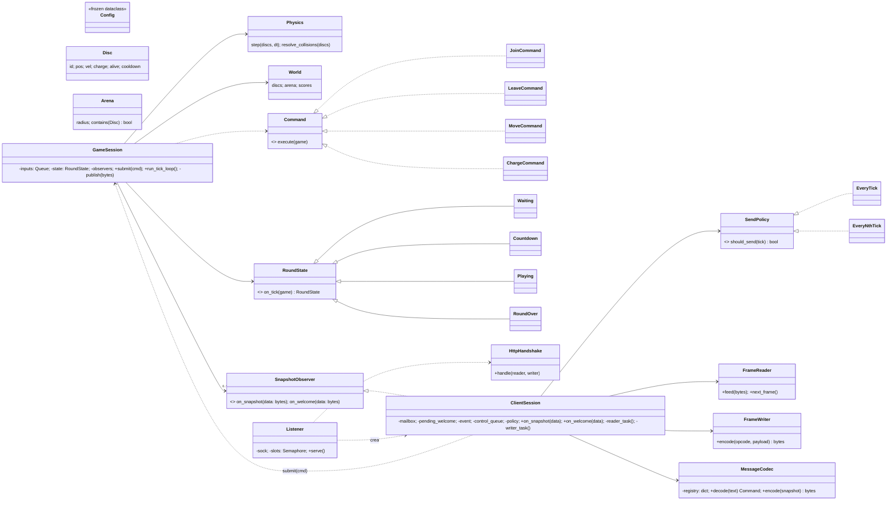

# StreetPunch — Diseño del Proyecto Final 2

21 de noviembre de 2026 · Max

## Fase 1: Planteamiento

El proyecto es un servidor concurrente de juego multijugador en tiempo real llamado **StreetPunch** (inspirado en StreetSmash; el repositorio conserva el nombre `streetsmash`), que cumple el Proyecto Final 2, Opción A (servidor TCP concurrente de tiempo real con estado compartido). Se entrega el miércoles 25 de noviembre de 2026; la sustentación es virtual.

**Qué es.** Cada jugador controla un disco en una arena vista desde arriba. Se mueve, carga una embestida y empuja a los rivales fuera del borde; el último en pie gana la ronda. El arte es propio: nada de personajes, fondos ni música de Nintendo. Se juega desde el navegador y el servidor es la autoridad: decide la física, las colisiones y las eliminaciones.

**Lo que se evalúa es el servidor, no el juego.** Todo el diseño parte de eso.

**Decisiones cerradas**

- Lenguaje: Python, solo librería estándar, sin framework. Django o Spring Boot esconden justo el socket, el stream de bytes y el modelo de concurrencia que califica la rúbrica.
- Transporte: WebSocket implementado por nosotros sobre un socket TCP creado a mano. El navegador no puede abrir TCP crudo; WebSocket va sobre `SOCK_STREAM`. El transporte vive en un módulo aparte.
- Entorno: Linux en WSL2, para tener `epoll`, SIGTERM y `/proc` reales.
- Plan A (se califica): demo simulada en `localhost`, compartiendo pantalla, con bots, pestañas del navegador y un video de respaldo grabado. No depende de internet ni de nadie más.
- Plan B (extra): después de la parte evaluada, el salón juega por internet. Despliegue en Railway, con túnel `cloudflared` como respaldo.
- La IA es par programador: explica cada concepto con archivo y línea, y cada error que se le encuentra va a la bitácora.

**Verificación contra el PDF**

| Lo que pide el profesor | Cómo se cumple |
| --- | --- |
| Varios clientes en tiempo real sin head-of-line blocking | El tick nunca espera a un socket; cada cliente tiene su tarea de envío con un buzón de tamaño 1 |
| Opción A: sockets TCP, `asyncio`, sincronización del estado | Socket manual, `asyncio`, único escritor, cola productor-consumidor, semáforo y regiones críticas sin `await` |
| Gestión explícita de sockets (`bind`, `listen`, `SO_REUSEADDR`) | Socket creado a mano con `listen(128)` y entregado a `asyncio` |
| Modelo de concurrencia justificado para el volumen de datos | Tabla comparativa con números medidos en la prueba de carga |
| Timeouts, SIGTERM, sin fugas de descriptores (EMFILE) | Tres timeouts, cierre ordenado, `finally` en cada cliente, demo con `ulimit -n 64` |
| Criterio 2: no asumir mensajes completos en `recv()`; protocolo definido | `FrameReader` incremental; protocolo documentado |
| Criterio 3: backpressure, límites, `shutdown`/`close` | Buzón que descarta lo viejo, tope de 100 conexiones, límite de entradas por tick |
| Criterio 4: bitácora y correcciones reales a la IA | `docs/bitacora-ia.md`, mínimo 5 errores con antes y después |
| Criterio 5: prueba de carga y explicación del kernel | Bots, cliente lento, `churn.py`; preparar backlog, `somaxconn`, `epoll` |

La rúbrica del Proyecto 2 no pide UML ni califica el repositorio, pero se entregan ambos: el diagrama de clases y el repositorio en GitHub.

## Fase 2: Requisitos y herramientas

Hay 17 requisitos funcionales y 14 no funcionales; **[N]** es el núcleo que se evalúa en el plan A y **[B]** es extra del plan B.

### Requisitos funcionales

| ID | Requisito | Tipo |
| --- | --- | --- |
| RF-01 | El servidor entrega la página en `GET /` y acepta WebSocket en `/ws` | N |
| RF-02 | El cliente envía su nombre (máx. 16 caracteres) y recibe id y color | N |
| RF-03 | Una arena, hasta 12 jugadores activos; los demás son espectadores en cola (cada ronda toma a los de la cola que más rondas llevan sin jugar). Cada ronda toma a los 12 primeros de la cola y los manda al final (rotación); el cliente muestra el turno de cada espectador | N |
| RF-04 | Si un jugador se desconecta su disco desaparece; si queda uno solo, la ronda termina | N |
| RF-05 | Fases: sala de espera (la ronda no arranca sola: la inicia el anfitrión, el conectado más antiguo, con `start`, y solo si hay mín. 2; todos ven en el marcador quién está en la sala; tras cada ronda se vuelve a la sala), cuenta regresiva (3 s), jugando, fin, resultados (3 s) | N |
| RF-06 | Marcador de rondas ganadas en memoria durante la sesión | N |
| RF-07 | Movimiento con aceleración, fricción y velocidad máxima; la fricción es menor por encima de esa velocidad (embestida y golpes) | N |
| RF-08 | Embestida: se carga hasta 1 s y al soltar da un impulso proporcional; enfriamiento de 1,5 s. Mientras se carga el disco no se mueve y las flechas solo apuntan la embestida | N |
| RF-09 | Colisiones elásticas; un disco en embestida empuja más | N |
| RF-10 | Salir del borde elimina; pasa a espectador hasta el fin de la ronda. Se elimina cuando el centro pasa del borde + `ELIMINATION_MARGIN_DISCS` radios (1.0: disco entero fuera) | N |
| RF-11 | Estado a 30 Hz para jugadores y 10 Hz para espectadores | N |
| RF-12 | Cliente con `canvas`, interpolación, nombres, carga, fase y marcador | N |
| RF-13 | Bots sin interfaz, `N` configurable | N |
| RF-14 | Cliente lento a propósito: conecta y no lee | N |
| RF-15 | Despliegue en Railway, con `cloudflared` de respaldo | B |
| RF-16 | Controles táctiles | B |
| RF-17 | Panel de métricas en la página | B |

### Requisitos no funcionales

| ID | Requisito | Rúbrica | Cómo se verifica |
| --- | --- | --- | --- |
| RNF-01 | Tick estable a 30 Hz con 12 jugadores y 50 espectadores; p99 < 5 ms | C1 | Métricas en la prueba de carga |
| RNF-02 | Sin head-of-line blocking: un cliente lento no altera el tick ni a los demás | C1 | Métricas con y sin cliente lento |
| RNF-03 | Socket manual: `SO_REUSEADDR`, `listen(128)`, no bloqueante, entregado a `asyncio` | C2 | Reinicio inmediato; revisión del código |
| RNF-04 | Framing RFC 6455: longitudes 7/16/64 bits, máscara obligatoria, ping/pong, close; tramas parciales se acumulan | C2 | `pytest` con tramas partidas |
| RNF-05 | Protocolo documentado: tipos, campos, semántica | C2 | `docs/protocolo.md` |
| RNF-06 | Backpressure: buzón de 1 que reemplaza; máx. 4 entradas por cliente por tick | C3 | Contador de descartes con el cliente lento |
| RNF-07 | Máx. 100 conexiones; tramas de 4 KB máx. | C3 | Prueba por encima del tope |
| RNF-08 | Timeouts: saludo 5 s, inactividad 30 s (ping cada 10 s), escritura 10 s | C3 | Cliente callado desconectado |
| RNF-09 | Cierre limpio con SIGTERM/SIGINT, close 1001, gracia de 2 s, código 0 | C3 | `kill -TERM` y logs |
| RNF-10 | Sin fugas de descriptores; con `ulimit -n 64` rechaza sin caerse | C3 | `ls /proc/<pid>/fd \| wc -l` |
| RNF-11 | No confiar en el cliente: validar todo, nunca aceptar posiciones | C3 | Mensajes malformados |
| RNF-12 | `AGENTS.md` obliga a la IA a explicar con archivo y línea; bitácora de cada sesión | C4 | `docs/bitacora-ia.md` |
| RNF-13 | Métricas: conexiones, tick p50/p99, descartes, descriptores | C1, C5 | Terminal durante la demo |
| RNF-14 | README con ejecución, protocolo y justificación numérica del modelo | C1, C5 | Repositorio |

### Herramientas

| Área | Herramienta | Por qué |
| --- | --- | --- |
| Servidor | Python 3.12+, librería estándar (`socket`, `asyncio`, `hashlib`, `base64`, `struct`, `json`, `signal`, `logging`) | Nada esconde los sockets |
| Cliente | HTML, JavaScript sin framework, `canvas` | Sin compilación; lo entrega el propio servidor |
| Entorno | WSL2 con Ubuntu, VS Code con extensión WSL | `epoll`, SIGTERM y `/proc` reales |
| Pruebas | `pytest`; bots propios con `asyncio` | El framing es lo que más se rompe |
| Diagnóstico | `ss -tlnp`, `/proc/<pid>/fd`, `ulimit`, `kill -TERM`, `websocat` | Evidencia de la demo |
| Repositorio | Git y GitHub | Pedido por el profesor |
| Agente de código | Claude Code, con `AGENTS.md` / `CLAUDE.md` | Que explique en vez de solo generar |
| Diagramas | Mermaid en el repositorio | GitHub lo muestra y se actualiza con el código |
| Plan B | Railway y `cloudflared` | Juego con el salón |
| Respaldo | OBS | Video de la demo |

### Valores configurables

Todos van en `config.py`: cambiar uno no toca código, y cada cambio necesita su porqué.

| Valor | Por qué este | Cuándo cambiarlo |
| --- | --- | --- |
| Tick 30 Hz | Fluido con interpolación; 33 ms por tick | A 20 Hz si falta ancho de banda (−1/3 de tráfico, ~100 ms de retraso visual) |
| Espectadores 10 Hz | Solo miran; ahorra 2/3 de su tráfico | A 30 Hz para tener una regla menos |
| Jugadores activos 12 | Máximo de StreetSmash; cabe en pantalla | A 8 si falta espacio o ancho de banda (crece como N × N) |
| Mínimo para iniciar 2 | Con uno no hay partida | No se cambia |
| Conexiones máx. 100 | 12 + ~50 espectadores + margen; el tope es nuestro, no del SO (1024) | Solo con mediciones de subida o RAM |
| Backlog `listen` 128 | Aguanta 100 bots a la vez; el kernel solo lo recortaría si superara `somaxconn` (4096 en este equipo, medido en P0) | A 512 si la carga muestra rechazos al arrancar |
| Buzón de salida 1 | Solo importa el último estado | A 2 si hay tirones por la red (+33 ms cada uno) |
| Cola de entradas 1024 | Acotada: la memoria no crece sin límite | Subir si se descartan entradas legítimas |
| Entradas por cliente por tick 4 | Suficiente para jugar; más es spam | Subir si se pierden teclas legítimas |
| Timeout de saludo 5 s | Un navegador tarda milisegundos; más indica slowloris | A 10 s si falla con conexiones lentas |
| Ping 10 s / inactividad 30 s | TCP tarda 2 h en detectar un cliente muerto | Inactividad a 60 s si se cae gente con mala conexión |
| Timeout de escritura 10 s | Libera clientes zombis | A 5 s si se llena el tope por zombis |
| Trama máx. 4 KB | Mensajes de ~50 B; evita reservar GB | A 1 KB para ser más estricto |
| Gracia de apagado 2 s | Tiempo para enviar el close | Subir si hay clientes que no lo reciben |
| Meta del tick p99 5 ms | 15 % del presupuesto | Es una meta medida, no una ley |
| Carga 1 s / enfriamiento 1,5 s | Jugabilidad | Se ajusta jugando |
| Cuenta regresiva y resultados 3 s; nombre 16 car. | Comodidad | Se ajusta jugando |
| Física (radio, velocidad, fricción) | Se fija el domingo | Siempre: desplazamiento por tick < radio, o hay tunneling |
| Caminar 170 px/s con aceleración 850; fricción 4 al caminar y 2 por encima de esa velocidad | Ajustado en P5 jugando: caminar solo posiciona y la embestida decide. Medido con `Physics`: la embestida pasó de alcanzar ~140 px a ~250 px y un rival golpeado de deslizarse ~115 px a ~270 px; caminar se sigue deteniendo en ~0,9 s | Si la embestida resulta demasiado fuerte, subir `SLIDE_FRICTION_PER_S` hacia 3 |

## Fase 3: Diseño

El servidor usa arquitectura de puertos y adaptadores (hexagonal) y un solo hilo con event loop, donde el tick es el único que modifica el estado.

### Estilo arquitectónico

- **Dominio** (puro): discos, física, arena, mundo, comandos, estados de ronda, marcador. No importa `asyncio` ni `socket`.
- **Aplicación**: `GameSession` (el tick), puertos (interfaces) y políticas de envío. Conoce interfaces, nunca un WebSocket concreto.
- **Adaptadores**: listener, saludo HTTP, framing WebSocket, codec JSON y `ClientSession`.
- **`main.py`** es el único que conecta todo y registra las señales.

Las dependencias siempre apuntan hacia adentro. Esto permite probar el juego con `pytest` sin sockets, cambiar el transporte tocando un módulo y señalar en el código dónde termina la red y empieza el juego.

### Modelo de concurrencia

| Tarea | Cuántas | Qué hace |
| --- | --- | --- |
| `accept_loop` | 1 | Acepta, reserva un cupo del semáforo y lanza la sesión; captura `OSError` (EMFILE) sin caerse |
| `reader` | 1 por cliente | Arma tramas, decodifica comandos y hace `put_nowait` en la cola de entradas; deja pong y close en la `control_queue` |
| `writer` | 1 por cliente | Único que escribe en el socket: primero el control (close, pong), luego el `welcome` pendiente, luego el buzón; `drain` con timeout de 10 s |
| `tick_loop` | 1 | Único escritor del estado: vacía la cola, ejecuta comandos, física, fase, codifica el estado a `bytes` una vez y lo publica |

### Recursos compartidos

La prueba para cada uno: ¿hay un `await` entre leer y modificar? Si no lo hay, es seguro sin lock.

| Recurso | Quién escribe / lee | Protección |
| --- | --- | --- |
| Cola de entradas | N `reader` / el tick | `asyncio.Queue(1024)` con `put_nowait`; llena = descartar y contar |
| Cola de membresía (`Connect` / `Disconnect`) | N `ClientSession` / el tick | `deque` que **nunca** descarta: perder un `Disconnect` dejaría un jugador fantasma y una sesión sin liberar. Acotada por el semáforo (≤ 2 por conexión) |
| Estado del juego y registro de jugadores | Solo el tick | Único escritor: entradas y salidas son `JoinCommand` / `LeaveCommand` |
| Lista de observadores | Solo el tick | Igual: suscribirse y darse de baja solo vía comandos |
| Socket de cada cliente | Solo su `writer` | `reader` deja pong y close en casillas de control (la `control_queue`, acotada a una casilla por tipo; el RFC permite contestar solo el ping más reciente); nunca dos escritores ni dos `drain` |
| Buzón de cada cliente | Tick / su `writer` | Región crítica sin `await` + `asyncio.Event`; orden: `wait()`, `clear()`, leer |
| `welcome` pendiente de cada cliente | Tick (vía `on_welcome`) / su `writer` | Igual que el buzón: casilla escrita sin `await` y el mismo `asyncio.Event` |
| Política de envío de cada cliente | Solo el tick | `GameSession` la elige en cada tick con un registro `{rol: SendPolicy}`; un espectador que entra a la ronda pasa solo a 30 Hz |
| Estado publicado | Tick / todos los `writer` | `bytes` inmutables, codificados una sola vez por tick |
| Cupos de conexión | `accept_loop` / cierre | `asyncio.Semaphore(100)`, liberado en `finally` |
| Contadores de métricas y de entradas por tick | Varias tareas | Incremento sin `await` en medio: atómico en un solo hilo |

**Condición de carrera que se demuestra.** La versión mala difunde con `await writer.drain()` por cliente y borra al jugador del diccionario apenas se desconecta. Con un cliente lento y `churn.py`, el mismo código congela a todos (head-of-line blocking) y rompe el recorrido (`dictionary changed size during iteration`). La versión buena usa `LeaveCommand` y envío desacoplado. La mala queda en la rama `demo/race-bug`. Opcional: el tope de conexiones con `if count < MAX` y un `await` en medio deja pasar 150 conexiones; el semáforo lo corrige.

**Por qué no `threading.Lock`.** Hay un solo hilo y el intercalado solo ocurre en un `await`. Si la física corriera en otro hilo, el estado sí necesitaría `threading.Lock`.

### Patrones de diseño

Solo donde resuelven un problema real.

| Patrón | Dónde | Problema que resuelve |
| --- | --- | --- |
| State | `RoundState`: `Waiting`, `Countdown`, `Playing`, `RoundOver` | Evita un `if fase ==` en cada paso del tick |
| Command | `JoinCommand`, `LeaveCommand`, `MoveCommand`, `ChargeCommand` | Separa cuándo llega una entrada de cuándo se aplica; base del único escritor |
| Observer | `GameSession` publica (`on_snapshot`) y avisa a uno (`on_welcome`); las `ClientSession` reciben | El tick no conoce sockets |
| Strategy | `SendPolicy`: `EveryTick`, `EveryNthTick` | Frecuencia distinta por rol sin `if` |
| Factory Method con registro | `MessageCodec`: `{"input": MoveCommand.from_msg, ...}` | Un mensaje nuevo no obliga a tocar el codec |

### SOLID

| Principio | Dónde se ve |
| --- | --- |
| S | `FrameReader` solo arma tramas; `MessageCodec` solo traduce JSON; `Physics` solo mueve; `Listener` solo acepta; `GameSession` solo coordina |
| O | Mensaje nuevo = `Command` + una línea en el registro; fase nueva = `RoundState`; política nueva = `SendPolicy`. El tick no se toca |
| L | Todo `RoundState` devuelve el siguiente estado y no lanza excepciones; todo `SnapshotObserver` es intercambiable, incluido el falso de las pruebas |
| I | Interfaces mínimas: `on_snapshot()` / `on_welcome()`, `execute(game)`, `on_tick(game)` |
| D | `GameSession` recibe `Config`, `Clock` y observadores por constructor; `main.py` arma el grafo |

### Protocolo (versión 1)

Tramas de texto WebSocket con JSON; ping, pong y close son tramas de control del RFC.

| Dirección | Mensaje | Ejemplo | Significado |
| --- | --- | --- | --- |
| Cliente → servidor | `hello` | `{"t":"hello","name":"Max"}` | Primer mensaje; sin él, cierre a los 5 s |
| Cliente → servidor | `input` | `{"t":"input","dx":1,"dy":-1,"seq":42}` | Dirección deseada; `seq` mide latencia |
| Cliente → servidor | `charge` | `{"t":"charge","on":true}` | Empieza o suelta la carga |
| Servidor → cliente | `welcome` | `{"t":"welcome","id":7,"color":"#e4572e","role":"player","arena":{...}}` | Identidad, rol y arena |
| Servidor → cliente | `state` | `{"t":"state","tick":1234,"phase":"playing","ms":null,"winner":null,"scores":{"7":3},"d":[[7,312.5,140.2,0.6,1]]}` | Estado completo: fase, tiempo restante, ganador, marcador y discos `[id,x,y,carga,vivo]` |
| Servidor → cliente | `error` | `{"t":"error","code":"bad_name"}` | Antes de un cierre por regla |

**Cada `state` se basta a sí mismo** (decisión del 21/11): no hay mensajes `phase` ni `round_end`. Si el buzón de tamaño 1 descarta un estado, el siguiente trae todo, así que ningún aviso se pierde. El cliente juega si su id aparece en `d`. Detalle completo en `docs/protocolo.md`.

Códigos de cierre: 1000 normal, 1001 apagado (SIGTERM), 1002 framing inválido, 1003 trama binaria, 1008 regla violada, 1009 trama grande, 1013 servidor lleno. El servidor es la autoridad: el cliente solo envía intenciones.

### Diagrama de clases



### Estructura del repositorio

```
streetsmash/
├── server/
│   ├── domain/        vector · disc · arena · physics · world · commands · round_states
│   ├── application/   game_session · ports · send_policies
│   ├── adapters/      listener · http_handshake · ws_frames · codec · client_session
│   └── config.py · metrics.py · main.py
├── client/            index.html · net.js · render.js · input.js
├── tools/             bots.py · slow_client.py · churn.py · fd_watch.sh
├── tests/             test_ws_frames · test_physics · test_round_states · test_codec
├── docs/              protocolo · justificacion-concurrencia · bitacora-ia · diagramas
├── AGENTS.md
└── README.md
```

## Fase 4: Pasos

Son 13 pasos entre el sábado 21 y el martes 24; el miércoles 25 solo se entrega.

**Ciclo de cada paso:** pedirle el paso a la IA citando este documento y `AGENTS.md`, leer el código con la lista de auditoría, correr las pruebas, anotar en la bitácora cada error real y hacer un commit pequeño.

**Entrada de la bitácora** (`docs/bitacora-ia.md`): fecha y paso · prompt · qué generó la IA · problema (concurrencia, sockets, protocolo o SOLID) · corrección con diff · por qué es un error · cómo se verificó.

### Sábado 21

- [ ] **P0. Entorno.** WSL2 con Ubuntu, Python 3.12+, Git y VS Code con extensión WSL. Listo cuando `python3 --version` y `sysctl net.core.somaxconn` responden; anota ese valor.
- [ ] **P1. Repositorio.** Estructura de la Fase 3, `AGENTS.md`, `docs/` con protocolo, diseño y plantilla de bitácora, y `config.py` con todos los valores comentados y la validación del tunneling. Listo con el primer commit en GitHub.

### Domingo 22

- [ ] **P2. Dominio y pruebas.** `Vec2`, `Disc`, `Arena`, `Physics`, `World`, comandos y estados de ronda. Auditar: `domain/` sin `asyncio` ni `socket`; ningún `if fase ==`; choques que conservan el momento; ningún `RoundState` lanza excepciones.
- [ ] **P3. Framing y saludo.** `FrameReader` incremental, `FrameWriter`, `GET /` y upgrade en `/ws` con `Sec-WebSocket-Accept`. Auditar: lecturas parciales, longitudes 126 y 127, rechazo sin máscara, tope de tamaño antes de reservar memoria. Pruebas con pedazos de 1 byte, varias tramas juntas y una de 5 KB rechazada.
- [ ] **P4. Listener, sesiones y tick.** Socket manual entregado a `asyncio.start_server(sock=...)`, semáforo, `reader`, `writer`, `control_queue`, buzón y tick de paso fijo con `loop.time()`. Auditar: llamadas bloqueantes, `drain` en la difusión, `finally` que cierra y libera, orden `wait`/`clear`/leer, `put_nowait`, un solo escritor por socket. Listo cuando un cliente de terminal recibe estados a 30 Hz.

### Lunes 23

- [ ] **P5. Cliente web.** `canvas`, interpolación de ~100 ms, teclado, carga, fases, marcador y vista de espectador. Ajustar valores de juego jugando con bots.
- [ ] **P6. Resiliencia.** Timeouts de saludo, inactividad y escritura; SIGTERM/SIGINT con close 1001; `accept` que resiste EMFILE; códigos 1008, 1009 y 1013. Auditar que ningún camino de error deje un socket abierto o un cupo sin liberar.
- [ ] **P7. Herramientas y carga.** `bots.py`, `slow_client.py`, `churn.py`, `fd_watch.sh` y métricas por segundo. Medir tick p50/p99, ancho de banda, descriptores, `ulimit -n 64` y el efecto del cliente lento.
- [ ] **P8. Rama `demo/race-bug`.** Difusión con `await drain()` por cliente y borrado directo del diccionario. Confirmar que falla de forma confiable; etiquetarla. Opcional: carrera del tope con 150 conexiones.
- [ ] **P9. Plan B.** Railway con `PORT` del entorno, `0.0.0.0` y `wss://`; prueba desde el celular con datos móviles; probar `cloudflared`.

### Martes 24

- [ ] **P10. Documentos.** Justificación del modelo con los números medidos (hilo por cliente, pool, multiproceso, `asyncio`), protocolo final, diagramas actualizados al código real y README.
- [ ] **P11. Bitácora.** Mínimo 5 errores reales con antes, después y explicación, priorizando concurrencia y sockets.
- [ ] **P12. Ensayo y video.** Guion: arrancar (`ss -tlnp`), pestañas y bots, cliente lento, `churn.py` malo contra bueno, descriptores, `ulimit -n 64`, `kill -TERM` y reinicio inmediato. Preguntas: colas SYN y de aceptación, backlog y `somaxconn`, `epoll` bajo `asyncio`, GIL, lecturas parciales, `TIME_WAIT` y `SO_REUSEADDR`, física en otro hilo. Grabar con OBS.

### Miércoles 25

- [ ] **Entrega.** Sin código nuevo: etiqueta `v1.0`, revisar README y, después de la parte evaluada, abrir el plan B al salón.

### Si hay atraso, recortar en este orden

1. Controles táctiles y panel de métricas web.
2. Railway (queda solo `cloudflared`).
3. Espectadores a 10 Hz (todos a 30 Hz).
4. Pulido visual del cliente.

Nunca se recortan: pruebas del framing, resiliencia, prueba de carga, demo de la condición de carrera y bitácora.
